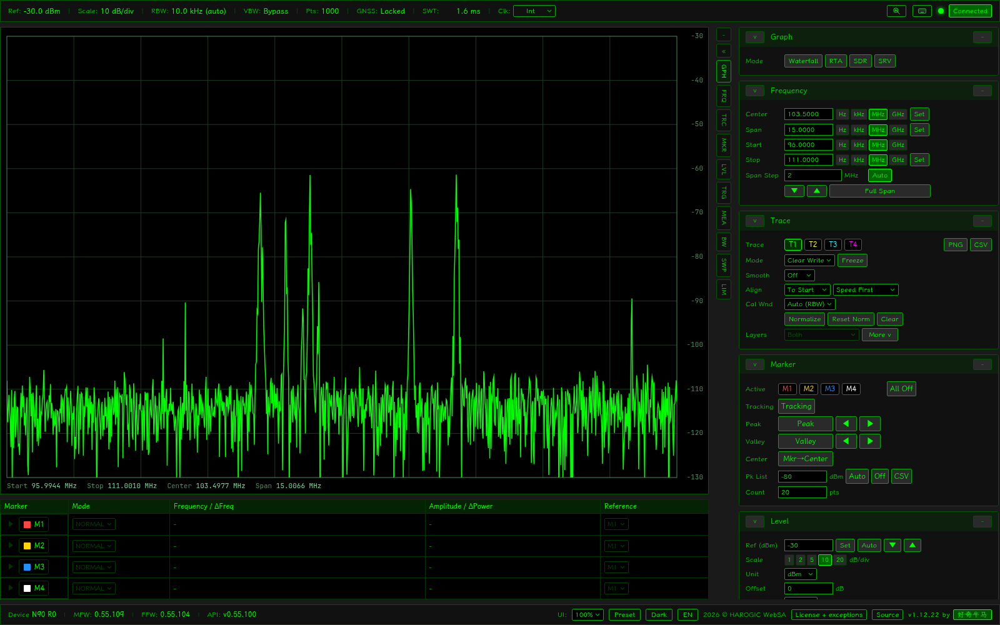

# Harogic WebSA

**Browser spectrum analysis and SDR reception for HAROGIC SAN-45 / SAN-60 / SAN-90.**

[简体中文](README.zh-CN.md) · [Documentation](docs/en/INDEX.md) · [Build and contribute](docs/en/DEVELOPMENT.md)



WebSA combines a native Rust acquisition/DSP service, a C++ adapter for the HAROGIC SDK,
and a TypeScript browser interface. Python runs the crash monitor, offline tools and tests.

Native measurements now report their bandwidth, method and validity; see [SNR definitions and reproducible validation](docs/en/reference/SNR.md).

## What it does

- Swept and real-time spectrum, four traces, density/waterfall, markers, channel power,
  occupied bandwidth, ACPR, harmonic and phase-noise measurements.
- Up to sixteen independently tuned receivers in one capture, local audio mixing with
  stereo routing and overall speaker EQ,
  floating channel/decoder windows and sixteen shared recording task slots.
- AM/DSB/USB/LSB/CW/NFM/WFM/PM, FM stereo/RDS, noise reduction, FT8, DRM/DRM+, SSTV
  and radiofax; optional external decoder providers extend the mode catalog.
- IQ, audio and decoded-result recording, saved-file playback/export, receiver presets,
  English/Chinese UI and light/dark themes.
- Exclusive SoapySDRServer handoff for external SDR clients.

Mode availability depends on installed providers and capture geometry. Sustained sixteen-channel
RF capacity remains unqualified; synthetic validation is not a hardware performance guarantee.
See [Known limitations](docs/en/OPERATIONS.md).

## Try it

The checkout includes a **Linux x86_64/glibc** runtime. The checked-in bundle is v1.12.5;
`make build` produces the current service and frontend. It currently requires glibc 2.44,
GLIBCXX 3.4.30, CXXABI 1.3.15 and `libfdk-aac.so.2`; rebuild if your system cannot run it.

```bash
./run.sh --fake                 # synthetic input, no analyzer required
./status.sh
./stop.sh
```

Open **http://127.0.0.1:8080**. For real hardware, install the separately supplied HAROGIC
SDK under `/opt/htraapi` and run `./run.sh`. The proprietary SDK is not bundled.
[Getting started](docs/en/GETTING_STARTED.md) covers prerequisites, instances and updates.

## Build and test

```bash
make native                    # Rust service, one build job
make frontend                  # browser assets
make sdk-shim                  # hardware adapter; vendor SDK required
./test.sh                      # native, Python and frontend tests
```

Run heavyweight commands separately to limit memory use. Restart the intended service after a
native rebuild; an existing process keeps its old executable. Full prerequisites, fixture/browser
checks and packaging are in [Development](docs/en/DEVELOPMENT.md).

## Find your way

| Need | Start here |
|---|---|
| Tune, listen, decode and record | [User guide](docs/en/USER_GUIDE.md) |
| Troubleshoot a device or service | [Operations](docs/en/OPERATIONS.md) |
| Understand the implementation | [Architecture](docs/en/ARCHITECTURE.md) |
| Integrate another client | [API](docs/en/reference/API.md), [receivers](docs/en/reference/RECEIVERS.md), [recordings](docs/en/reference/RECORDINGS.md) |
| Install optional providers | [Tools](tools/README.md) |

`backend/` owns the service and hardware boundary; `dsp/` owns shared signal-processing
kernels; `frontend/` owns browser interaction; `contracts/` holds shared limits;
`tests/` and `tools/` hold regression fixtures and offline tooling.

## License and attribution

Project-owned code that we can authorize uses [AGPL-3.0-only](LICENSE) with a
[section 7 linking exception](LICENSE-EXCEPTION) for **HAROGIC SDK and FDK AAC only**
(`LicenseRef-Harogic-WebSA`). Project code and modifications retain their applicable
Corresponding Source obligations, including the modified network version's source offer.
The UI links to the license texts and a versioned local source snapshot.

Third-party code, libraries, models and independent decoders retain their original terms;
see [scope and earlier MIT grants](LICENSING.md), [third-party notices](THIRD_PARTY_NOTICES.md)
and [review evidence / unresolved rights](docs/en/LICENSING.md). Earlier MIT releases remain
available under their original [MIT grant](LICENSES/MIT-legacy.txt). The proprietary HAROGIC
SDK must still be obtained separately; the exception supplies no vendor redistribution rights.

Author: [好奇牛马 (Bilibili)](https://space.bilibili.com/28447213).
