# Harogic SAN 系列频谱仪 Web 上位机 (SAN-45 / SAN-60 / SAN-90)

**English: [README.md](README.md)**

用于 **Harogic SAN 系列频谱仪**（SAN-45 / SAN-60 / SAN-90，海得逻捷）的浏览器上位机。原生 Rust 服务通过 C++ shim 调用官方 `libhtraapi.so` SDK，经 USB 连接设备。

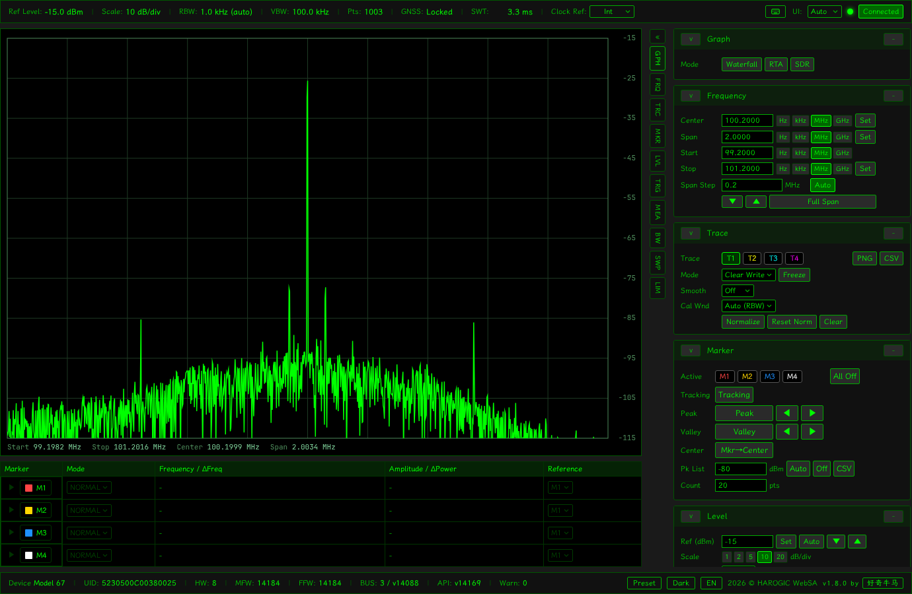

## 设备实拍

| SAN-90 | SAN-90 + WebSA 实拍 |
|---|---|
| 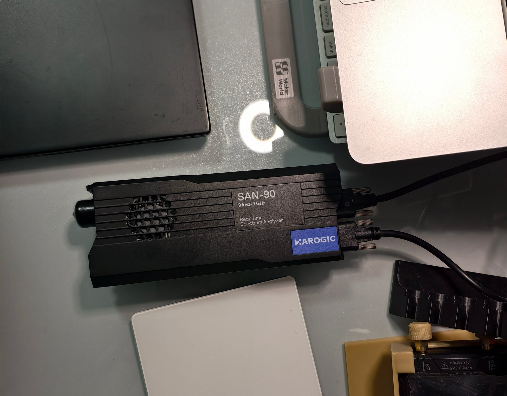 | 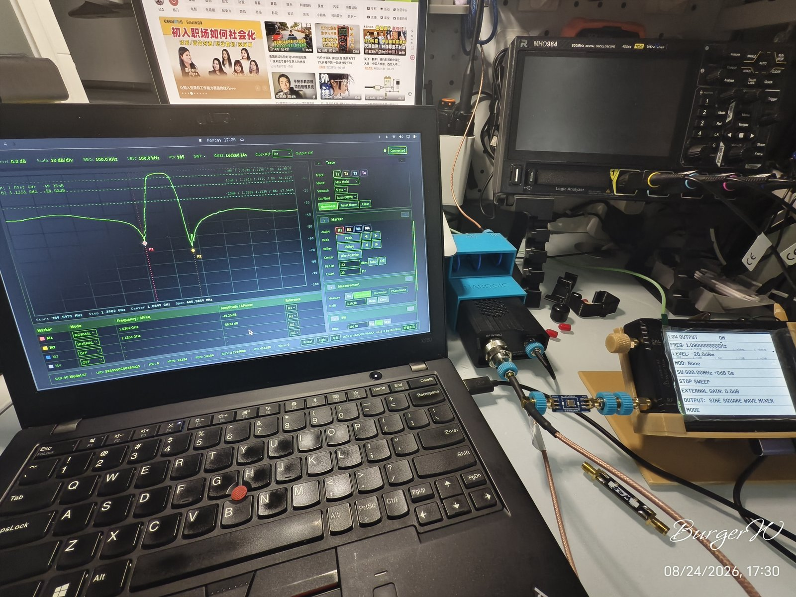 |

## 特性

- **窄带 SDR 采集** — 采集范围可宽于请求频带，全景图仅显示请求范围；信道化器选择适合接收器的输出采样率
- **频谱显示** — 清除写入 / 最大保持 / 最小保持 / 平均 / 冻结查看，支持 4 条迹线、平滑与保峰重采样
- **显示缩放** — 放大已采集的频谱；概览窗显示完整范围，瀑布图跟随同一视窗
- **SDR 调谐步进** — 按采集带宽分别保存方向键步进，预设范围为 1 Hz 至 100 MHz；To Center 将信号移至中心
- **控制面板** — Center/Span 与 Start/Stop 原子联动、Span Step 与 Full Span、RBW/VBW/点数、
  FFT 窗口、衰减/前置放大/中频增益、手动或一次性 Auto Ref Level、参考时钟与输出
- **标记** — 4 个标记、独立跟踪、按峰值排序分配、寻峰寻谷、Savitzky-Golay 平滑
- **实时频谱 (RTA)** — FPGA 引擎、多迹线、概率密度背景、瀑布图
- **测量模式** — 幅度（n-dB 带宽）、谐波（H1~H5）、相噪
- **信道测量** — 信道功率、占用带宽（90/95/99%）、邻道功率比（ACPR）
- **SDR 接收** — IQ 流式传输与原生 Rust DSP：AM/DSB/USB/LSB/CW/NFM/WFM/PM 解调、
  降噪（Wiener，可选 DeepFilterNet3）、音频处理、频谱与瀑布图；浏览器负责控制、播放与显示
- **数字模式** — FT8、CW 解码、DRM/DRM+ 接收及 SSTV 图像解码（18 种模式）。FT8 窗口支持通联高亮、正则过滤与列排序。解码和播放边界见[已知限制](docs/zh-CN/KNOWN_ISSUES.md)。
- **FM 立体声与 RDS** — WFM 用 19 kHz 导频和 38 kHz 差分信号恢复左右声道，
  从 57 kHz 信号解码 PI、台名与 RadioText。FM 面板显示基于导频的 STEREO/MONO 指示、频偏、
  音频电平及左右声道示波器。该指示仅表示存在导频，当前节目的左右声道内容仍可能相同。
  默认启用立体声，原生音频流输出双声道；显式关闭立体声时使用单声道。
- **AM 分析** — 默认包络检波，可切换带积分载波跟踪的同步检波；显示恢复的 RF 载波频率、锁定状态、平滑后的调制度与输入电平、音频电平及最终 PCM 波形。标题 badge 显示同步锁定状态，悬停提供时序详情；检波开关位于载波频率旁。
- **触发与辅助** — RTA 设备电平触发与扫描模式软件触发；限制线与通过/失败余量；归一化；PNG/CSV 导出。
  RTA 捕获完成由设备与帧元数据确认；fixture 输入不模拟硬件触发命中。
- **界面** — 侧边导航条、可选虚拟键盘、幅度单位与外部增益/线损补偿、深浅主题、中英文
- **设备连接监控** — 拔线时在画布上显示提示，重新接入后自动恢复原模式，无需重启服务

## 界面截图

| 深色主题 | 中文界面 | 浅色主题 |
|---|---|---|
|  | 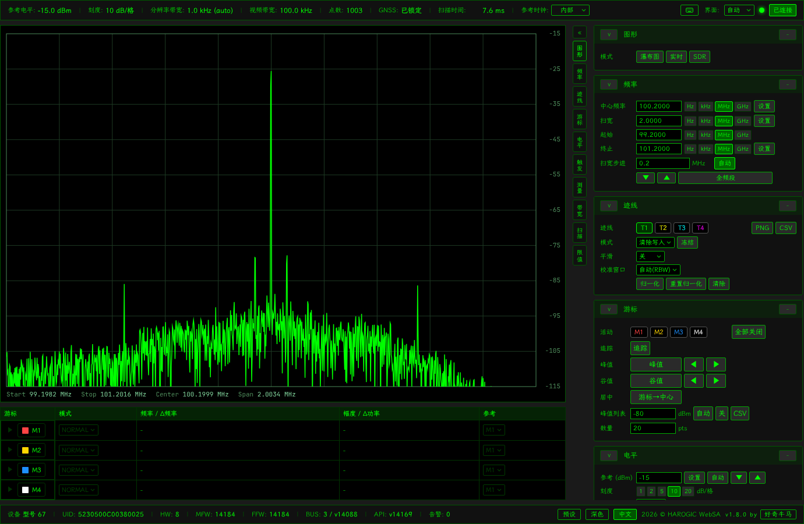 | 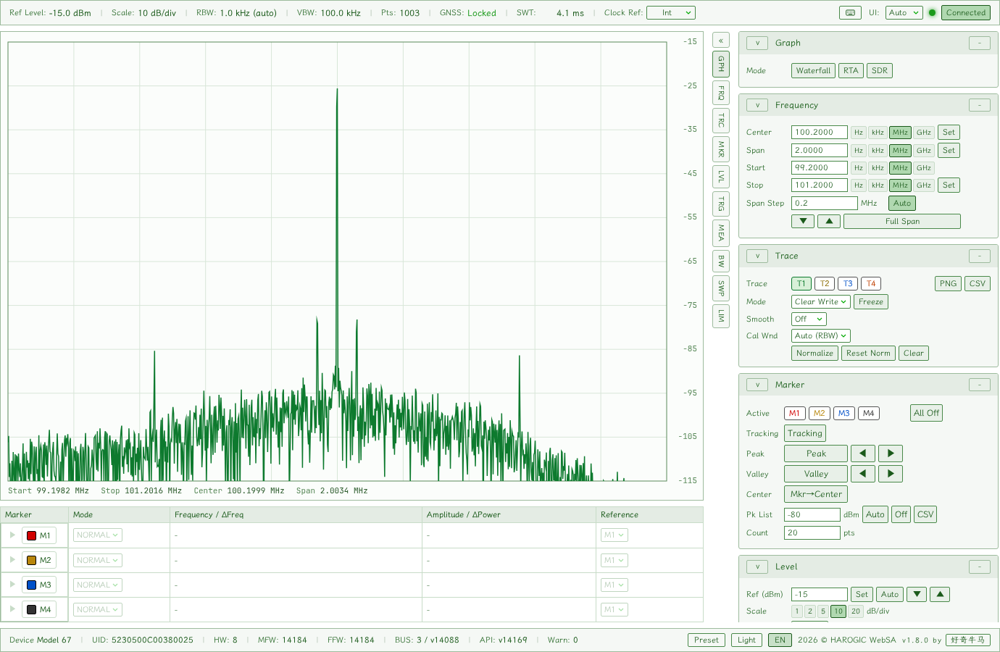 |

| 多点寻峰 | 谐波测量 | 相噪测量 |
|---|---|---|
| 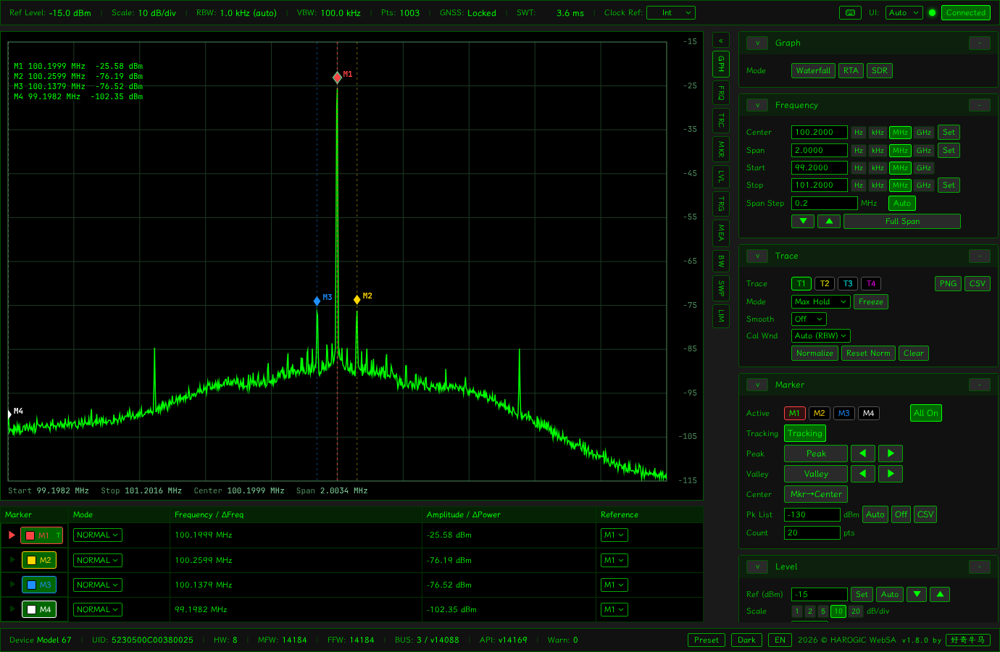 | 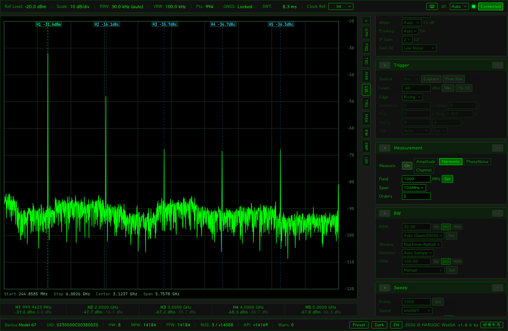 | 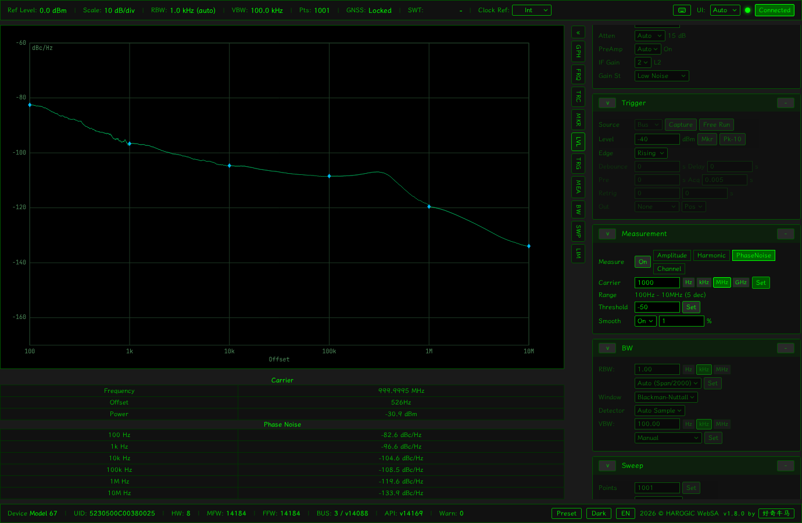 |
| 幅度测量 | RTA + 瀑布 | |
| 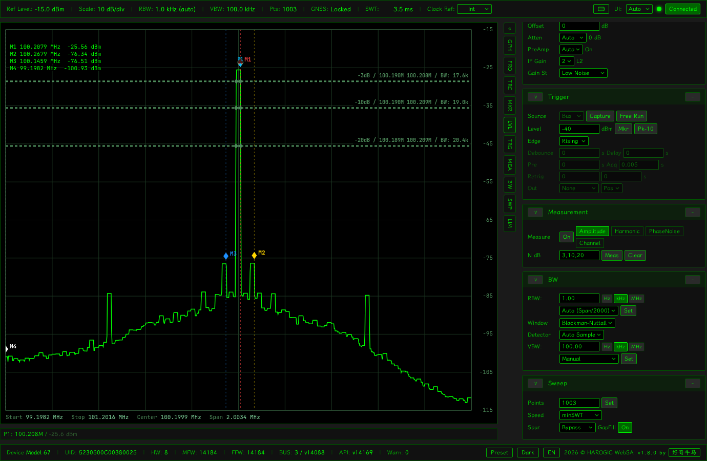 | 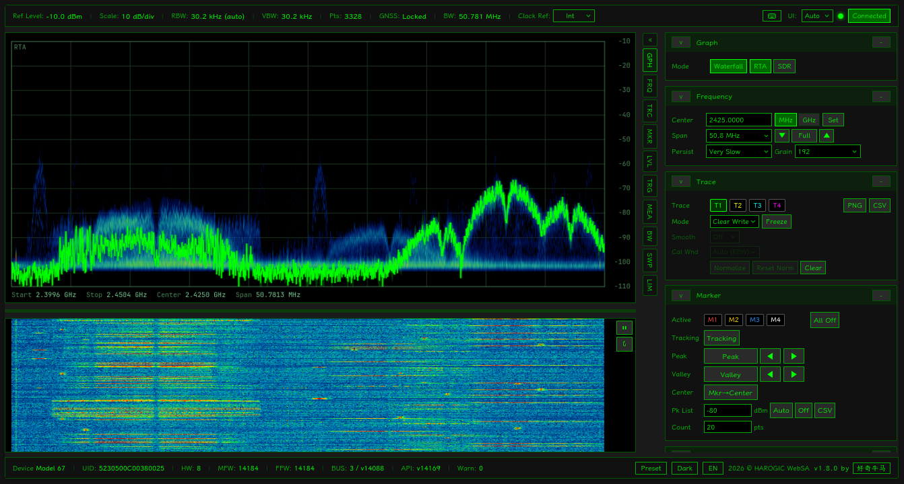 | |
| FT8 解码 (SDR) | CW 解码 (SDR) | |
| 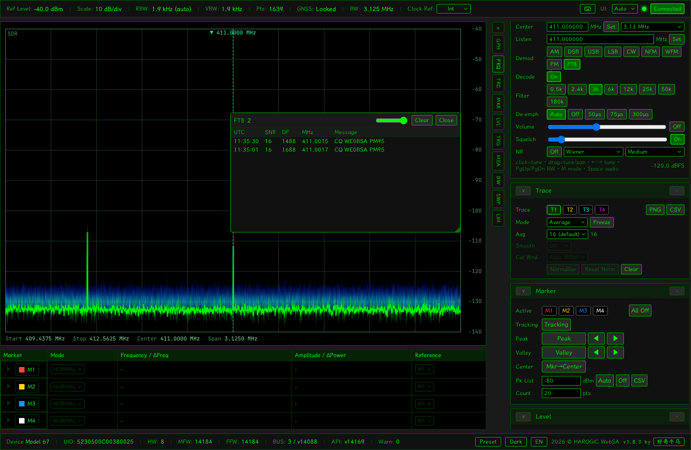 | 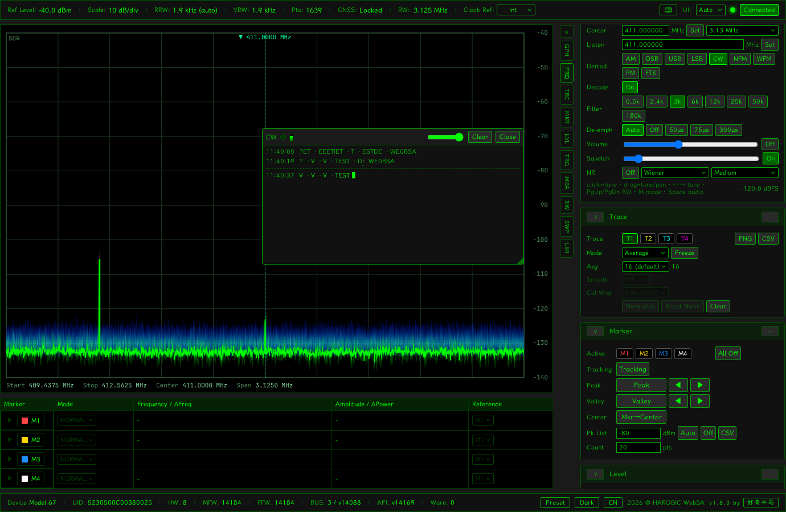 | |

## 快速开始

**1.9.0** 使用原生 Rust PFB/DDC 采集与接收处理链路。Python 仅用于离线工具和测试，
不再提供生产后端。保留的浏览器 WASM 产物是可选离线诊断工具，不是生产 DSP 路径。

### 运行随附发布产物

1.9.0 仓库包含 `runtime/linux-x86_64/websad`、本项目 SDK 适配库
`runtime/linux-x86_64/libwebsa_san90_sdk_session.so` 以及 `runtime/frontend/dist/`。
执行 `./run.sh` 连接硬件，或执行 `./run.sh --fake` 使用合成输入，然后访问
http://127.0.0.1:8080。使用随附产物无需安装 Rust、Node.js 或 Python。
硬件运行仍须自行将 HAROGIC SDK（包括 `libhtraapi.so.0`）安装到 `/opt/htraapi`；
仓库不包含专有 SDK。

数字模式的合成回放还需要仓库中已跟踪的 `tests/fixtures/`；仅复制 `runtime/` 不足以使用
这些 fixture。`run.sh` 将工作目录设为仓库根目录；`WEBSA_FIXTURES` 可指定其他 fixture 目录。

二进制仅面向 **使用 glibc 的 Linux x86_64**，构建主机为 Arch Linux。服务与适配库合计
要求 GLIBC 2.44、GLIBCXX 3.4.30、CXXABI 1.3.15，以及系统 ELF 加载器、
`libstdc++.so.6`、`libgcc_s.so.1`、`libm.so.6`、`libc.so.6` 和 `libfdk-aac.so.2`。
SDK 还需要自己的依赖（已观察到 libusb、liquid-dsp、OpenMP、pthread 和 dl）。
这不是可移植或静态链接发行包；较旧发行版或其他架构须从源码重建。
重建和打包方法见[开发指南](docs/zh-CN/DEVELOPMENT.md)。

`run.sh` 优先使用本地重建的 `native-ddc/target/release/websad` 和 `frontend/dist/`，
否则使用随附文件。`WEBSA_BIN` 可覆盖服务程序路径。硬件适配库依次选择显式设置的
`WEBSA_RUST_IQS_SHIM`、用户目录中已安装的 shim、随附适配库。

服务本身要求 GLIBCXX 3.4.29 和 CXXABI 1.3.9；随附 SDK 适配库将整体要求提高到上述版本。
ELF 加载器路径为 `/lib64/ld-linux-x86-64.so.2`。适配库链接时使用 SDK 0.55.100，
库搜索路径为 `/opt/htraapi/lib/x86_64`；其他 SDK 安装位置须通过 `SDK_ROOT` 重建适配库。
尚未验证 Linux x86_64 范围之外的 CPU 兼容性。

### 前置条件

- 启动脚本需要 Linux、systemd 用户服务、`curl` 和 `ss`（iproute2）；原生音频解码需要
  FDK AAC 动态库（`libfdk-aac.so.2`，版本 ≥2.0.3）。
- 仅原生重建需要 Rust、C++17 编译器和 pkg-config。
- Python ≥3.10 仅用于台架、端到端、离线参考和 fixture 工具，不提供生产后端。
- Node.js — 仅重建前端和运行前端测试时需要：22.22+ / 24.15+ / ≥26（测试工具要求的最低版本；仅运行 Vite 构建
  只需 22.12+）。Node 18/20/23 未纳入验证范围。
- Harogic SAN 系列频谱仪 + 官方 SDK：
  - `htra_api.py` — 仓库根目录保留的厂商离线工具包装器（HAROGIC 版权）
  - `libhtraapi.so` — **专有二进制，请从 HAROGIC 官方获取**；SDK 头文件与库安装到 `/opt/htraapi`

### 1. 从源码重建

```bash
make native sdk-shim                     # 原生服务与硬件 SDK shim
./build.sh                               # 前端资源；WASM 用 make wasm 显式重建
```

### 2. 运行

```bash
./run.sh
```

浏览器打开 http://127.0.0.1:8080

默认连接真实硬件；启动脚本按上文规则选择用户已安装的 shim 或随附适配库。
模拟数据源须通过 `WEBSA_FAKE=1 ./run.sh` 显式启用。`WEBSA_UNIT`、`WEBSA_HOST`、`WEBSA_PORT`、
`WEBSA_RUST_IQS_SHIM`、`WEBSA_STATIC` 配置原生启动入口；日志由 systemd 用户 journal 管理。
`./stop.sh` 与 `./status.sh` 管理同一原生单元。

服务会检测并上报频谱仪断开，重新接入后自动恢复原模式，无需重启；`make status` 查看实时连接状态，
`make restart` 重启服务。

默认仅监听本机。本地和局域网访问不需要令牌：

```bash
WEBSA_HOST=0.0.0.0 ./run.sh
```

然后访问 `http://设备地址:8080/`。[运行 FAQ](docs/zh-CN/FAQ_NOTES.md) 说明环境变量、日志和恢复。
直接运行 `native-ddc/target/release/websad` 且不提供硬件 shim 时默认使用 8099 端口的 fixture 输入；
`run.sh` 除非明确请求假源，否则选择 8080 硬件模式。

当前文档：[架构](docs/zh-CN/ARCHITECTURE.md)、[HTTP/WS API](docs/zh-CN/API.md)、
[模式与参数流转](docs/zh-CN/MODE_STATE_FLOW.md)、[开发指南](docs/zh-CN/DEVELOPMENT.md)、
[已知限制](docs/zh-CN/KNOWN_ISSUES.md)及[工具](tools/README.md)。

### 3. 测试

```bash
pip install -r requirements-dev.txt      # 可选开发/bench/e2e 工具
make ci                                  # 本地无硬件门禁
make e2e-fake                            # 原生 fixture 服务与浏览器检查
make hw-test                             # 需真机：tinySA CW + 界面状态机回归
```

## 目录结构

```
harogic-websa/
├─ native-ddc/           Rust 服务、信道化器与 C++ SDK shim
├─ wasm/                 原生共享 Rust DSP crate 与浏览器 WASM
├─ wasm-dfn/             DeepFilterNet 集成
├─ frontend/             TS 前端 (Vite + TypeScript, i18n + 主题)
│  └─ src/__tests__/     vitest 测试(DSP 引擎, 合成迹线)
├─ htra_api.py           厂商离线工具 Python wrapper（HAROGIC 版权）
├─ docs/                 双语架构、API、运行、开发与 codec 参考
├─ tests/                reference/工具测试及共享协议/DSP fixture
├─ tools/                硬件冒烟 + e2e + 性能基线 + 质量门禁
│  └─ checks/            architecture_guard.py + baseline.json（适应度函数）
│  └─ reference/         离线 sdk_bindings/ddc/native_ddc/spectrum/demod/filters/framer/sdr_capture.py
├─ screenshots/          README 截图
├─ run.sh / stop.sh / status.sh / clean.sh / build.sh / test.sh / Makefile
├─ pyproject.toml / requirements.txt / LICENSE / .gitignore
```

## 脚本

日常操作及提交前检查所用的命令：

| 脚本 | 说明 |
|---|---|
| `./run.sh` / `./stop.sh` | 启动 / 停止原生 systemd 用户服务 |
| `make restart` / `make status` | 重启 / 查看运行状态、PID、内存、CPU、日志、设备链路 |
| `make build` | 前端资源 + 原生 Rust 服务（硬件 shim 单独构建）|
| `make native` / `make sdk-shim` | 构建 Rust 服务 / 硬件 SDK shim |
| `make frontend` | 仅构建前端：npm install + Vite 构建（不构建 WASM）|
| `make wasm` | 构建两个 WASM 内核；`make wasm-dsp` / `make wasm-dfn` 单独构建其中一个 |
| `make clean` / `make clean-all` | 前者清理缓存和 dist，保留依赖及 Rust targets；后者同时清理依赖及 Rust targets；均保留已提交的 WASM |
| `./test.sh` | 原生契约测试 + Python 工具测试 + Ruff + 前端 Vitest |
| `make ci` | 本地无硬件门禁；与工作流的差异见开发指南 |
| `make e2e-fake` | 原生 fixture 服务上的浏览器检查 |
| `make hw-test` | **需真机**：tinySA CW 冒烟 + 界面状态机回归 |
| `make bench` | 与已记录的性能基线比较 |

[开发指南](docs/zh-CN/DEVELOPMENT.md)和[工具指南](tools/README.md)说明 fixture 重生成、守卫、文档/版本检查和硬件依赖。

## 测试

- **原生 Rust**、**Python 工具/参考**与**前端 Vitest** 测试覆盖服务契约、协议/DSP、参数槽位与
  i18n 一致性；共享基准 fixture 覆盖帧格式与 DSP 内核。Python 不承担生产后端或运行时回退职责。
- **默认无需硬件**：本地检查与原生 fixture 浏览器检查覆盖确定性服务行为和 DSP 契约。`make hw-test` 需要频谱仪及 tinySA CW 信号源。模拟数据源或单元测试通过，不能证明持续 RF 性能。
- 硬件结果受设备、固件、主机负载和浏览器图层影响。已有截图及测量仅作示例，不表示每次检出代码后都重新完成了硬件验收。将已有性能基线用于原生服务比较前，须核对配置与来源。

## 开源说明

- 项目代码（后端 + 前端）：**MIT** 协议
- `htra_api.py`：HAROGIC 官方 SDK Python 包装，版权归 HAROGIC（海得逻捷）；随项目附带供配合自有 SDK 使用
- `libhtraapi.so`：专有二进制，**不在本仓库**，需从 HAROGIC 官方获取
- 截图使用真实 SAN-90 拍摄（SDR 数字模式截图使用 PlutoSDR 作为信号源）
- `tools/vendor/ggmorse/`：CW（莫尔斯）解码器来自 Georgi Gerganov 的
  [ggmorse](https://github.com/ggerganov/ggmorse)，**MIT** 协议，保留上游提交
  `7b4822a8`（见 `tools/vendor/ggmorse/LICENSE`）。`native-ddc/cw_build.rs` 将其与本项目的
  `native-ddc/native/ggmorse_bridge.cpp` 桥接代码一起编译进原生服务。


---

## 作者

[好奇牛马 (B站)](https://space.bilibili.com/28447213)
