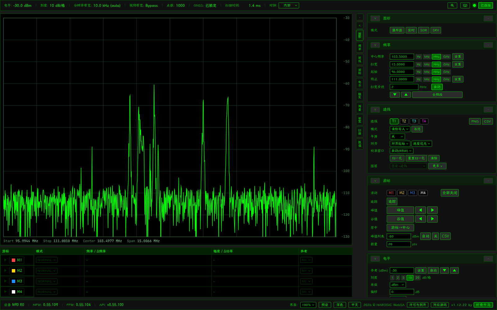

# Harogic WebSA

**面向 HAROGIC SAN-45／SAN-60／SAN-90 的浏览器频谱分析与 SDR 接收工具。**

[English](README.md) · [文档目录](docs/zh-CN/INDEX.md) · [构建与贡献](docs/zh-CN/DEVELOPMENT.md)



WebSA 由原生 Rust 采集／DSP 服务、连接 HAROGIC SDK 的 C++ 适配器及 TypeScript 浏览器界面组成。
Python 用于离线工具和测试。

## 主要功能

- 扫频及实时频谱、四条迹线、密度／瀑布、标记、信道功率、占用带宽、ACPR、谐波和相噪测量。
- 一个采集窗口内最多十六个独立调谐信道、本地混听、信道／解码悬浮窗，以及共享的十六个录制任务名额。
- AM／DSB／USB／LSB／CW／NFM／WFM／PM、FM 立体声／RDS、降噪、FT8、DRM／DRM+、
  SSTV 和无线电传真；可选外部 provider 扩展解码目录。
- IQ、音频及解码结果录制，文件试听／导出，信道预设，中英文界面和明暗主题。
- 向外部 SDR 客户端提供独占 SoapySDRServer 接管。

模式可用性取决于已安装 provider 和采集几何。十六路持续 RF 容量仍待验收；合成验证不构成硬件
性能保证。详见[已知限制](docs/zh-CN/OPERATIONS.md)。

## 试用

仓库包含 **Linux x86_64/glibc** 运行包，当前要求 glibc 2.44、GLIBCXX 3.4.30、
CXXABI 1.3.15 和 `libfdk-aac.so.2`；系统不兼容时请源码构建。

```bash
./run.sh --fake                 # 合成输入，无需分析仪
./status.sh
./stop.sh
```

打开 **http://127.0.0.1:8080**。真实硬件需将单独取得的 HAROGIC SDK 安装于 `/opt/htraapi`，
然后运行 `./run.sh`。仓库不包含专有 SDK。[快速开始](docs/zh-CN/GETTING_STARTED.md)
说明依赖、独立实例及更新方式。

## 构建与测试

```bash
make native                    # Rust 服务，单构建任务
make frontend                  # 浏览器资源
make sdk-shim                  # 硬件适配器，需要厂商 SDK
./test.sh                      # 原生、Python 和前端测试
```

重任务分别执行，控制内存占用。重建原生服务后须重启目标实例，旧进程不会自动切换可执行文件。
完整依赖、模拟／浏览器检查和打包方法见[开发指南](docs/zh-CN/DEVELOPMENT.md)。

## 查找资料

| 任务 | 入口 |
|---|---|
| 调谐、监听、解码和录制 | [用户指南](docs/zh-CN/USER_GUIDE.md) |
| 排查设备或服务问题 | [运行与排障](docs/zh-CN/OPERATIONS.md) |
| 理解实现 | [架构](docs/zh-CN/ARCHITECTURE.md) |
| 对接客户端 | [接口](docs/zh-CN/reference/API.md)、[接收机](docs/zh-CN/reference/RECEIVERS.md)、[录制](docs/zh-CN/reference/RECORDINGS.md) |
| 安装外部 provider | [工具](tools/README.md) |

`backend/` 负责服务及硬件边界，`dsp/` 负责共享信号处理内核，`frontend/` 负责浏览器交互，
`contracts/` 保存共享限制，`tests/` 和 `tools/` 保存回归样本及离线工具。

## 许可与致谢

项目主程序使用 [MIT](LICENSE)。厂商代码、codec、模型权重和独立 provider 各有许可，
详见[依赖与许可说明](docs/zh-CN/DEVELOPMENT.md#依赖与许可)。HAROGIC SDK 属于专有软件，须单独获取。

作者：[好奇牛马 (Bilibili)](https://space.bilibili.com/28447213)。
