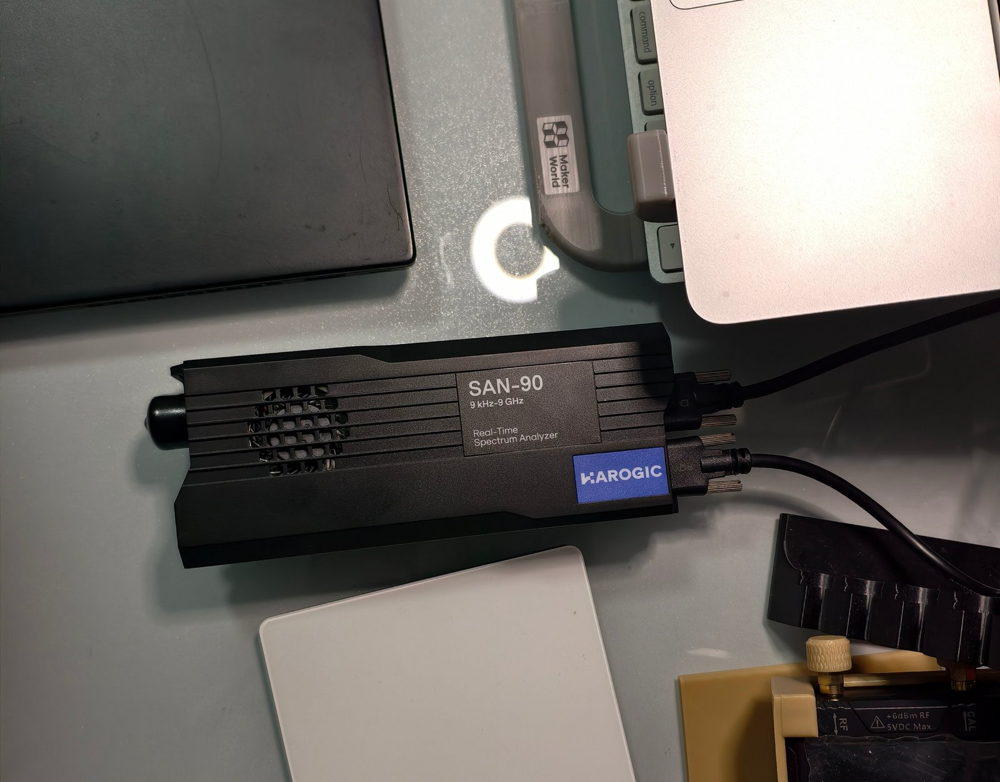

# Getting started

[Documentation](INDEX.md)

## Choose a runtime

The checked-in runtime is v1.12.5. Build the current service/frontend with `make build`,
or use a matching candidate package.

WebSA runs on Linux. The repository includes a Linux x86_64/glibc service, SDK adapter and
frontend under `runtime/`. The recorded bundle requires glibc 2.44, GLIBCXX 3.4.30,
CXXABI 1.3.15 and `libfdk-aac.so.2`; it is not a static or generally portable distribution.
Rebuild on older systems or other architectures using [Development](DEVELOPMENT.md).

Hardware operation requires a SAN-45/SAN-60/SAN-90 and the separately supplied HAROGIC SDK
under `/opt/htraapi`, including its shared-library dependencies. The proprietary SDK is not
included. Fixture mode needs no analyzer or SDK, but uses this checkout's `tests/fixtures/`.
Bash, coreutils, util-linux (`flock`), `/proc`, curl and Python 3 support the launcher and
its crash monitor. Rust and Node are unnecessary for running the bundle.



## First-time setup

On Linux x86_64, run `make setup` after cloning to build the current frontend/service,
prepare the native NR runtime, and install multimon-ng, rtl_433, OnAir, RTTY and GPS
(GNSS-SDR plus its bridge). Builds run sequentially. Decoders share
`${XDG_DATA_HOME:-$HOME/.local/share}/websa/decoders`; installed executables are reused.
Use the [individual installers](../../tools/README.md#external-decoder-setup) to reinstall a provider.

Install the [source build prerequisites](DEVELOPMENT.md#build-from-source) first. The full
decoder setup also needs CMake, Git, curl and a C toolchain. GPS needs development files for
GNU Radio, Boost, VOLK, BLAS/LAPACK, HDF5, OpenSSL, pugixml, matio, protobuf, libpcap and
FFTW, plus build-time Python with Mako. Run `bash tools/setup-gnss-decoder.sh --help` for
the full list. The check reports missing prerequisites before downloads/builds; GNSS-SDR's
CMake configuration also checks its full dependency set. Setup runs no sudo or system package installs.

```bash
./setup.sh --check              # check only; no downloads or file changes
make setup                     # initial source builds/downloads may take a while
make run
make decoders-status
```

For hardware, obtain the HAROGIC SDK separately and install it at `/opt/htraapi`
(or use `make setup SDK_ROOT=/path/to/sdk`). With the SDK present, setup also builds the
adapter and Soapy driver; this needs SoapySDR development files, SoapyRemote,
`SoapySDRUtil` and `patch`. Without the SDK, start fixtures with `WEBSA_FAKE=1 make run`.

Daily commands remain `make run` / `make stop` / `make restart`. After setup updates,
run `make restart` and reload the browser. `make decoders-status` reports availability
and failure reasons from the running service. Use `./setup.sh --without-gps` to omit
GPS and its build dependencies when it is not needed. For a custom decoder directory,
use the same `WEBSA_DECODERS_PREFIX` for setup and launch; per-provider paths are unnecessary.

## Launch

From the repository root:

```bash
./run.sh --fake                 # synthetic input, without hardware
./status.sh
./stop.sh
./run.sh                        # real hardware, with the SDK installed
```

Open **http://127.0.0.1:8080**. Close other applications holding the analyzer before launching.
The launcher starts a checkout-scoped background process; it does not install a system service.
Fake signals demonstrate controls and known fixtures, not RF sensitivity or sustained capacity.

For a separate fixture instance:

```bash
WEBSA_INSTANCE=demo WEBSA_PORT=8099 ./run.sh --fake
./stop.sh --instance demo
```

## Select files and network access

The launcher prefers `backend/target/release/websad` and `frontend/dist/`, falling back to
`runtime/linux-x86_64/websad` and `runtime/frontend/dist/`. `WEBSA_BIN` and `WEBSA_STATIC`
can override these choices; the static setting is the directory containing `dist/`.
The SDK adapter selection is `WEBSA_RUST_IQS_SHIM`, then the installed user adapter, then
the runtime adapter. `WEBSA_FIXTURES` overrides the fixture directory.

Loopback is the default. `WEBSA_HOST=0.0.0.0 ./run.sh` enables LAN access on port 8080;
product HTTP endpoints have no authentication. WebSockets require a same-origin request or
an origin listed in `WEBSA_ALLOWED_ORIGINS`. Set `WEBSA_PORT` to change the port.

## Update and first use

Stop the instance, rebuild or replace its matching service/frontend/adapter outputs, then
start it again and run `./status.sh`. Building does not update an already running process.
Use [Development](DEVELOPMENT.md) for source and packaging commands.

Start with a spectrum view, choose SDR, select a frequency inside the capture and enable
Listen. [Receiver workflow](USER_GUIDE.md) explains channel selection, local audio and recording.
For missing libraries, silent audio or device errors, see [Operations](OPERATIONS.md).
