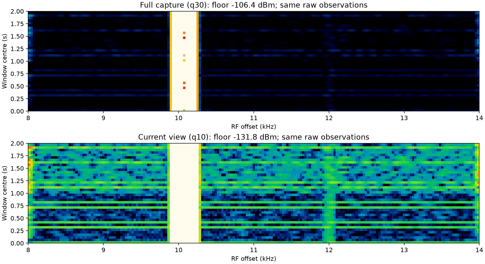
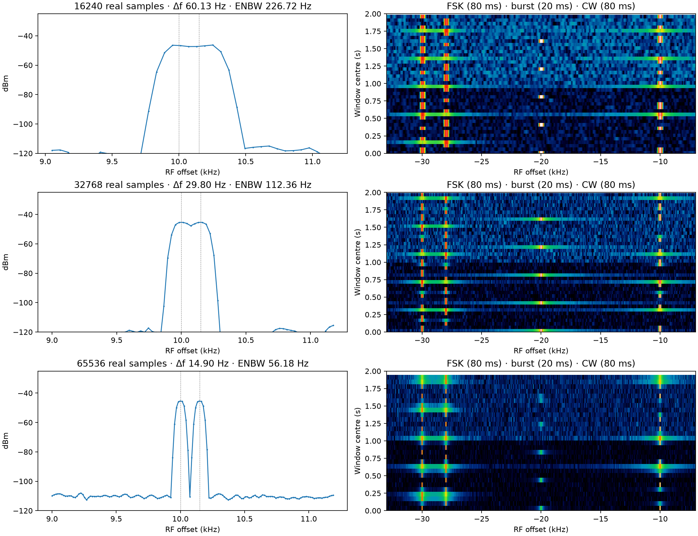
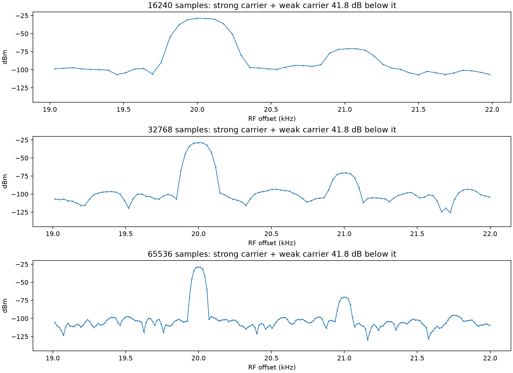
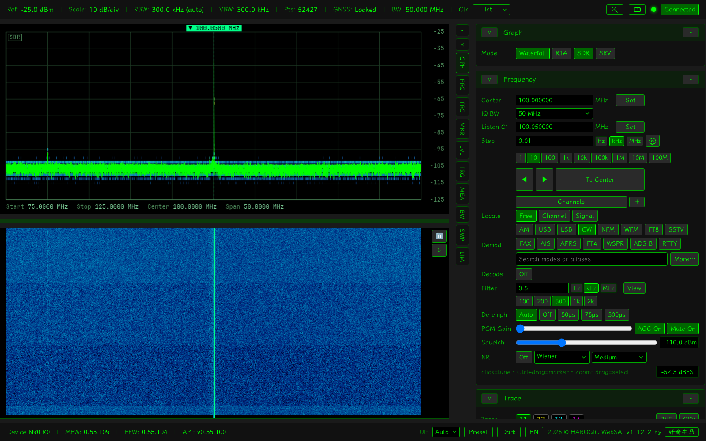
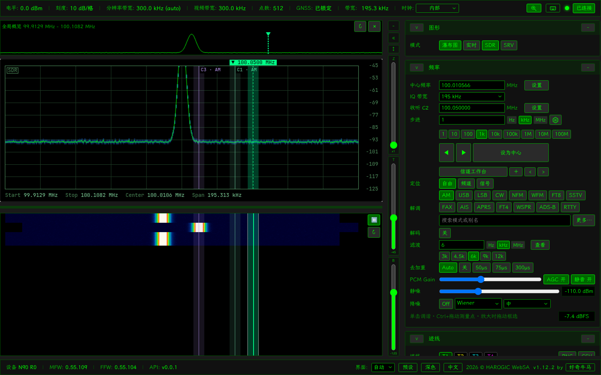

# SDR display validation — 2026-11-04 / SDR 显示验证

Implemented on the existing uncommitted working tree; earlier keypad, focus, RF history, zoom and palette changes are retained. Host: Intel i5-8250U, 4 cores / 8 threads; SDK 0.55.100; headless Chromium, 1600×1000, DPR 1. Measurements below are short acceptance runs, not a long-duration load qualification.

在原有未提交工作区上继续实施，保留上一会话的键盘、焦点、RF 历史、缩放和配色修改。主机为 i5-8250U（4 核 8 线程），SDK 0.55.100；浏览器为 1600×1000、DPR 1 的无头 Chromium。下述为短时验收，不代表长时间满负载认证。

## Noise floor / 噪底

Full Capture preserves the existing per-observation q30, 1.5 s tracking, −6 dB lower margin and 55 dB span. Current View uses native retained bins in the exact shared Hz window, including retune previews. It selects q10 from the newest overlapping observation; fewer than 32 finite bins, coverage below 25%, or q10 above that observation's capture q30 + 12 dB falls back to capture q30. No data holds the last range, initially −120 dBm. Only colour limits are smoothed; observations remain independent. Current View recolours the entire history with one range. Paused browsing derives a deterministic target from frozen history, smooths colour limits toward it, then stops. Later live frames cannot alter that target; a returned view restores identical colours after settling. Fixed ignores the source setting. A broadband signal and a raised noise floor are intrinsically ambiguous; the occupancy guard conservatively favours weak signals.

整幅模式保留逐行 q30、1.5 秒平滑、下限低于噪底 6 dB、范围 55 dB。视窗模式按两图和刻度实际共同显示的 Hz 范围，从最新重叠观测的原始频点取 q10；有效点不足 32、覆盖少于 25%，或 q10 高于该观测整幅 q30 超过 12 dB 时回退整幅。无数据保持上次色阶，初始噪底 −120 dBm。只平滑色阶，不混合观测行；视窗模式统一重着色整张历史。暂停后按冻结历史确定目标色阶，只平滑色阶参数直到稳定，随后停止；后续实时帧不能改变目标。固定范围忽略来源设置。宽带信号和噪底抬升无法仅凭幅度完全区分，保护策略优先保留弱信号。

Reference pinned to [OnAir `19044d33` (2026-10-31), waterfall.h](https://github.com/adswill/OnAir/blob/19044d33f4ae3848a464ce5783c53f56927d1caa/app/gfx/waterfall.h) and [spec_pipe.h](https://github.com/adswill/OnAir/blob/19044d33f4ae3848a464ce5783c53f56927d1caa/app/gfx/spec_pipe.h): `fitRange` crops `viewU0/viewU1` and falls back below 32 bins; `noiseFloor` selects approximately q10 from about 2048 finite samples; `FloorTracker` uses 2 s and a 15 dB snap. WebSA retains its own 1.5 s tracking without that snap and does not adopt row averaging or integer-column RF shifts. See the [English architecture](../../en/ARCHITECTURE.md) / [中文架构](../../zh-CN/ARCHITECTURE.md) for the memory and historical-colouring policy.



The synthetic 32768-sample example has 201 native view bins: capture q30 ≈ −106.4 dBm, view q10 ≈ −131.8 dBm. The weak line at +12 kHz becomes visible. Plots use the application's Classic Colour anchors and one scale across each image; all source rows remain unchanged. 合成示例包含 201 个视窗原生频点；视窗噪底下降后，+12 kHz 处弱线可见。图中使用应用的经典彩色色带，每张图使用统一色阶，原始观测行相同。

## Real FFT and calibration / 真实 FFT 与校准

The production default is **16240**, not the probe's 2048 or the fixture's 512. The live IQS packet size and its checks remain 16240. [SDK probe output](sdk-probe.txt) records configuration on one DSP context in order 16240 → 32768 → 65536 → 32768 → 16240, actual input lengths, returned points, RBW ratios and real processing. The API guide 0.55.89 §§25.4–25.5 / §26.56 and installed 0.55.100 header define `FFTSize`, `SamplePts`, `ProfileOut`, `TracePoints`, `RBWRatio`, window and intercept; observed `ProfileOut` is validated by the new shim entry points. Each optional analyzer has its own pure DSP context and bounded worker. `rustfft` is already available but a custom Rust normalization/calibration path was unnecessary after SDK capability and timing validation.

生产默认为 **16240**，不是探针的 2048 或 fixture 示意频谱的 512。IQS 包长及校验仍为 16240。探测记录证明同一 DSP 上下文可动态往返配置三档，输入长度与请求一致；生产 shim 校验实际配置及返回点数。已核对本机 API 文档与头文件。新档位使用独立纯 DSP 上下文和有界线程；SDK 已通过能力和耗时验证，因此不另建 Rust FFT 的功率归一化与校准路径。

| Real input samples / 真实样本 | SDK output before RF crop / 裁剪前输出 | Δf at 976562.5 S/s | FlatTop ENBW | Observation / 观察窗 |
|---:|---:|---:|---:|---:|
| 16240 | 12992 | 60.133 Hz | 226.717 Hz | 16.630 ms |
| 32768 | 26215 | 29.802 Hz | 112.362 Hz | 33.554 ms |
| 65536 | 52429 | 14.901 Hz | 56.181 Hz | 67.109 ms |

At the production 3.90625 MS/s capture used below, FFT spacings are 240.53 / 119.21 / 59.60 Hz; at full 62.5 MS/s they are 3848.52 / 1907.35 / 953.67 Hz. The 149 Hz synthetic pair result applies to the explicitly stated 976562.5 S/s input, not to full-rate RF.

实际 3.90625 MS/s 采集时三档频点间距为 240.53 / 119.21 / 59.60 Hz；62.5 MS/s 时为 3848.52 / 1907.35 / 953.67 Hz。149 Hz 合成双载波结论对应明确列出的合成采样率，不能外推为全速率 RF 分辨率。

The actual FFT spacing is Fs/N. SDK output coordinates use a slightly different endpoint-inclusive spacing, retained in [synthetic.json](synthetic.json); output points and spacing therefore do not define the observation length. FlatTop uses coherent gain ≈0.21557895 and ENBW ≈3.77025 Fs/N. The vendor complex-IQ power convention is `20 × |FFT(I+jQ · window)|² × scale² / (N² × coherent_gain²)` mW. With 10000 ADC codes and `scale_to_v=1e-6`, the calibrated coherent carrier is −26.9897 dBm. Measured errors for the three sizes are −0.00043 / −0.00023 / −0.00011 dB. Optional `Calibration=false` matches the existing SDK path; voltage scale and window/power normalization are still applied.

真实频点间距为 Fs/N；SDK 返回轴采用略有差别的端点等间距坐标，原样保留，不能由输出点数反推真实观察窗。FlatTop 相干增益约 0.21557895，等效噪声带宽约 3.77025 Fs/N。以上给出与默认路径相同的厂商 IQ 电压/功率约定；三档对已知幅度合成载波的误差均小于 0.001 dB。`Calibration=false` 沿用默认设置，不意味着忽略 IQ 电压标度或窗增益归一化。

A single seeded, quantized complex-IQ sequence contains a 149.012 Hz carrier pair, a weak carrier 41.8 dB below a nearby strong carrier, 80 ms CW/FSK, 20 ms bursts and a noise change at 1 s. Every FFT consumes a complete genuine N-sample segment; there is no zero padding. The pair is merged at 16240; the selected 32768 window has two maxima with a 2.34 dB valley; 65536 gives a 65.23 dB valley. Relative phase changes the exact valley depth. Longer windows broaden inherent transient timing: 65536 at this synthetic rate spans 67.1 ms and cannot assign a 20 ms burst a 20 ms boundary. There is no additional averaging between rows. A fixed 20 fps observation schedule may miss bursts between windows; this acceptance does not claim continuous POI.

同一组合成 IQ 验证相邻载波、强弱信号、CW、FSK、短突发及噪底变化；默认档相邻载波合并，更大观察窗产生双峰。相对相位会影响谷深。更长 FFT 自身降低时间分辨能力：此采样率下 65536 窗为 67.1 ms，不能把 20 ms 突发边界解释为 20 ms 精度；代码没有额外跨行平滑。20 fps 的独立观察窗之间可能漏掉突发，本验收不声称连续截获概率。




## SAN-90 + TinySA / 真机

TinySA ULTRA+ ZS407, firmware `tinySA4_v1.4-223-gbc116a4`, CW 100.05 MHz, requested −42 dBm through a cable into SAN-90. Each tier was measured for 5 s after settling, with native CW audio/decode processing and continuous IQ recording across tier changes. Requested display decimate 256 kept the production-selected **3.90625 MS/s** capture; full display used **62.5 MS/s**. FFT selection did not change either capture rate, receiver identity or epoch. [Measured data](live.json) includes both rates, Chromium process CPU/RSS, heap/backing stores, history bytes, native timing and health counters.

TinySA 与连接线未做溯源校准；真机只验证档位间幅度一致性，不声称绝对 RF 精度。FFT 设置没有改变生产链路选定的采集率、接收器身份或 epoch。每档稳定后测量 5 秒，并持续进行 CW 音频/解码及跨档 IQ 录制。

Full capture at 62.5 MS/s; CPU percentages use **one logical core = 100%**. Chromium RSS sums its processes and may double-count shared pages. Receive-to-paint timing starts at WebSocket delivery, excluding RF acquisition, USB transport and serial-source latency.

| FFT | Backend CPU | Chromium CPU | Backend / Chromium RSS (MiB) | Wire MiB/s | Display fps | Receive→paint p95 | CW median |
|---:|---:|---:|---:|---:|---:|---:|---:|
| 16240 default | 117.6% | 91.6% | 211.8 / 524.3 | 2.982 | 19.99 | 13.8 ms | −42.319 dBm |
| 32768 | 131.2% | 118.4% | 213.3 / 544.7 | 6.007 | 20.00 | 17.6 ms | −42.290 dBm |
| 65536 | 145.5% | 149.3% | 221.9 / 571.9 | 11.042 | 18.39 | 24.4 ms | −42.294 dBm |

Full-capture 32768 / 65536 observations are 0.524 / 1.049 ms; measured native FFT means were 0.982 / 2.113 ms, maximum 1.691 / 3.947 ms. Additional transport/queue timing is in the raw benchmark output under `/tmp/websa-sdr-live-final`. The noise floor changed −102.415 → −105.467 → −108.478 dBm: about −3.05 / −6.06 dB, consistent with narrower ENBW. This does not represent an RF gain change. 相同 RF 载波最大档位差约 0.03 dB；噪底下降约 3/6 dB 来自噪声带宽变窄，不是测量增益改变。

All six runs had zero IQ timestamp gaps, zero display job drops and zero receiver queue-full counts. Each 5 s interval produced approximately 240–242k audio samples and 93–107 decode messages. Two recording archives completed, each retaining one identity and one segment across all three tiers: **550 / 646 blocks**, **48540 / 52326 complex samples**. The independent archive reader validated CRCs, complete footers, input clocks and output clocks without gaps. TinySA output was disabled and the owned test service stopped on exit.

六轮均无采集时间戳断裂、显示作业丢弃或接收器队列满；音频、解码持续输出。两段录制跨三档切换保持单一身份和段落，独立读取验证 CRC、结束标记以及输入/输出样本时钟连续。测试结束已关闭 TinySA 输出并退出测试服务。未做真实 RF 双载波、调制 FSK/CW 边沿、持续数小时运行或绝对 RF 校准；这些范围不能由单个真机 CW 冒充。

The final combined run enabled **Current View + 65536 FFT**, filled the history for 30 s, then measured 5 s: **14.91 fps**, backend **143.4%** of one core, Chromium **144.4%**, RSS **229.2 / 589.5 MiB**, **8.954 MiB/s**, receive→paint p95 **39.0 ms**. All **512 × 52427** native amplitudes survived: rows plus the shared Float64 axis occupied exactly **54,104,664 bytes (51.60 MiB)**, below the 64 MiB history budget. Capture and receiver queues remained healthy; its independently validated recording also had continuous sample clocks. This is slower than the default and is the cost of finer live analysis and full-history recolouring. Native audio counters in this combined interval advanced by 219291 samples (4.57 audio seconds over 5.03 wall seconds); asynchronous counters alone do not establish glitch-free playback. Audio was muted in these RF runs, so audible playback under sustained load remains unverified. [Combined-run data](live-view.json).

最终组合场景为“当前视窗噪底 + 65536 FFT”，先填充 30 秒历史后测量：约 **14.91 fps**；保留 **512 行 × 52427 原生频点**，幅度行与复用频率轴合计 **51.60 MiB**。采集无时间戳断裂，录制样本时钟连续，音频/解码计数继续增长；该轮 5.03 秒墙上时间内音频计数增长 219291 个样本（约 4.57 秒音频），不能仅凭异步计数证明无播放卡顿。RF 测量时保持静音，持续负载下的可听播放未验收。该场景比默认显示慢，32768 可作为较低资源开销的可选档位。



## Browser and checks / 浏览器与检查

- Full frontend run: 105 files / **1677 tests passed**; two new FFT UI confirmation/fallback tests passed separately. Final changed waterfall/UI subset: **40 tests passed**. Production build passes (existing >500 kB bundle advisory only).
- Final backend full run: **264 passed, 3 conditional skips**. Final display FFT validation: **4 passed**; actual vendor DSP admission/calibration test run separately: **passed**.
- Browser: both frequency editors, Enter→plot→Step arrows, keypad confirmation/cancel/shortcut ownership; continuous slider sweep and both ends; overview pan; held new FFTs during retune preview and further zoom changes; paused retune out/back; Auto/Fixed/source switches restoring history; probability density still visible; amplitude sliders independent of waterfall. Atomic diagnostics compare both plots' exact Hz window and constant frozen row count. [Browser data](browser.json): 41 continuous slider redraws, median **7.8 ms**, p95 **12.9 ms**, max **31.3 ms** on the 512-bin transport fixture. This is UI regression evidence, not real FFT resolution evidence.
- Native-bin tests retain the full 52429-bin pair/valley and enforce shared-axis accounting, complete-row eviction and the 64 MiB budget. Larger supported SDR input is never reduced to 16384 columns.

浏览器 fixture 的 512 点仅证明交互和冻结历史契约，真实分辨能力由上面的真实 IQ→SDK 处理和真机数据另证。瀑布行最多 512，原始幅度及共享 RF 轴限 64 MiB，投影缓存限 8 MiB；反复 retune 超预算时淘汰完整旧行。内存预算细节及极端画布尺寸的渲染开销见架构说明。



## Reproduce / 复现

Requires SDK headers/library under `/opt/htraapi`, C++, Rust, frontend dependencies, and Python with numpy, matplotlib, Playwright Chromium, pyserial and websockets. In this session Python dependencies were temporary under `/tmp/websa-plot-deps`; no system or shared virtualenv was modified.

```sh
make sdk-shim SDK_SHIM=/tmp/libwebsa_fft_sdk.so
cargo build --release --manifest-path backend/Cargo.toml --bin websad
npm --prefix frontend run build
c++ -O2 -I/opt/htraapi/inc tools/bench/sdk_fft_probe.cpp -L/opt/htraapi/lib/x86_64 -Wl,-rpath,/opt/htraapi/lib/x86_64 -l:libhtraapi.so.0.55.100 -o /tmp/websa-fft-probe
/tmp/websa-fft-probe
python tools/bench/sdr_display_fft.py --shim /tmp/libwebsa_fft_sdk.so --output /tmp/websa-sdr-synthetic
python tools/e2e/sdr_channel_shortcuts.py --artifacts /tmp/websa-sdr-browser
```

With the explicitly connected TinySA RF output cabled to SAN-90, and no competing radio owner:

```sh
python tools/bench/sdr_display_live.py --shim /tmp/libwebsa_fft_sdk.so --serial /dev/ttyACM1 --output /tmp/websa-sdr-live --seconds 5
```

The live script controls a −42 dBm CW, records IQ, measures all tiers, and switches output off in `finally`. Device paths and output command dialect must match the connected TinySA. 实机脚本使用本次确认的 ULTRA+ `output normal` 命令；其他固件须按设备返回的命令格式调整。

## Release 1.12.3 checks / 版本收尾检查

The final controls rename Auto Floor to 自动底噪 in Chinese and move waterfall range/limits, floor source, palette, contrast and Display FFT into Graph with mode-specific visibility and availability. Both plots share the passband square/H preference, and the waterfall top arrows use the spectrum's preview/release bandwidth gesture. Density retains the chosen amplitude bins through the supported long FFT sizes; its values/link budget is now 96 MiB, as documented in the architecture.

最终控件已更名并迁入图形区，两图共用方块/H 通带开关，瀑布顶端支持带宽预览及松开提交。长 FFT 不再压缩密度谱幅度分档，新的内存预算见架构说明。快速模式切换修复了未确认期间点击仍高亮的旧模式误发 `std` 的问题；两个方向均有真实按钮绑定的回归测试。端到端测试保留 3 秒限制，同时等待后端与浏览器确认。

| Check / 检查 | Result / 结果 |
|---|---|
| Version sync / 版本同步 | `1.12.3`; apply and `--check` passed |
| `make ci` | 938 Rust tests passed, 48 ignored optional/diagnostic cases; 146 Python tests passed; 106 frontend files / 1690 tests passed; Ruff, fixture generation, static/document checks and production build passed |
| `make e2e-fake` | UI smoke, complete state regression and resolution sweep passed; all five rapid mode switches completed in 0.1–0.2 s; viewport findings: 0 |
| SDR channel/zoom browser regression / 信道与缩放浏览器回归 | `tools/e2e/sdr_channel_shortcuts.py` passed |
| Runtime packaging / 运行包 | Rebuilt service, frontend and shim packaged; all three display FFT symbols retained in the stripped adapter |

These release checks use fixture input and do not replace the separate RF/SDK evidence above.
这些收尾检查使用 fixture 输入，真实 RF 与 SDK 的验证范围仍以上面的独立记录为准。
