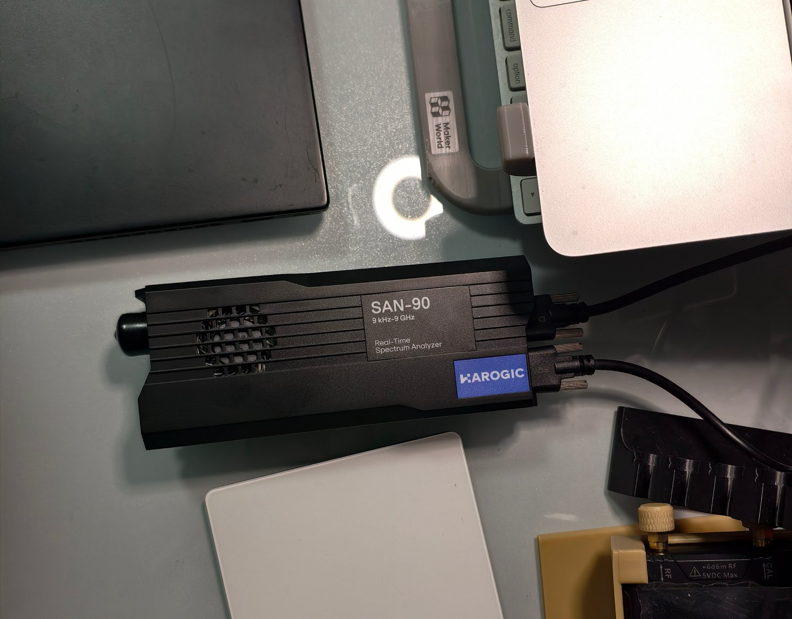

# 快速开始

[文档目录](INDEX.md)

## 选择运行方式

已提交 runtime 的版本为 v1.12.5。使用 `make build` 构建当前服务／前端，
或使用同版本候选包。

WebSA 运行于 Linux。仓库的 `runtime/` 包含 Linux x86_64/glibc 服务、SDK 适配器和前端。
已记录的捆绑版本要求 glibc 2.44、GLIBCXX 3.4.30、CXXABI 1.3.15 和 `libfdk-aac.so.2`；
它不是静态或通用跨发行版分发。旧系统或其他架构请按照[开发指南](DEVELOPMENT.md)重新构建。

硬件模式需要 SAN-45／SAN-60／SAN-90，以及单独取得、安装于 `/opt/htraapi` 的 HAROGIC SDK
及其共享库依赖。专有 SDK 不包含在仓库中。模拟模式无需分析仪或 SDK，但需要仓库的
`tests/fixtures/`。启动脚本依赖 Bash、coreutils、util-linux（`flock`）、`/proc` 和 curl。
启动器及崩溃监护还需要 Python 3；运行捆绑版本不需要 Rust 或 Node。



## 首次安装

Linux x86_64 用户在 clone 后运行 `make setup`，统一构建当前前端／服务，准备原生降噪运行库，
并安装 multimon-ng、rtl_433、OnAir、RTTY 和 GPS（GNSS-SDR＋桥接程序）。安装顺序执行，
解码器集中到 `${XDG_DATA_HOME:-$HOME/.local/share}/websa/decoders`，已有程序会复用。
重新安装单个 provider 时使用[原有安装脚本](../../tools/README.md#external-decoder-setup)。

先安装[源码构建依赖](DEVELOPMENT.md#源码构建)。全部解码器还需要 CMake、Git、curl 和 C 工具链；
GPS 需要 GNU Radio、Boost、VOLK、BLAS/LAPACK、HDF5、OpenSSL、pugixml、matio、protobuf、
libpcap、FFTW 的开发文件和带 Mako 的构建用 Python。完整清单可执行
`bash tools/setup-gnss-decoder.sh --help` 查看。检查会在下载／构建前列出缺少的前置依赖；
GNSS-SDR 的 CMake 配置还会检查它的完整依赖。脚本不执行 sudo 或系统包安装。

```bash
./setup.sh --check              # 只检查，不下载或修改文件
make setup                     # 首次源码构建和下载可能较久
make run
make decoders-status
```

硬件需另行取得 HAROGIC SDK，安装至 `/opt/htraapi`（或 `make setup SDK_ROOT=/path/to/sdk`）。
检测到 SDK 时，setup 还会构建适配器和 Soapy 驱动；此时另需 SoapySDR 开发文件、
SoapyRemote、`SoapySDRUtil` 和 `patch`。未安装 SDK 时，可用 `WEBSA_FAKE=1 make run` 启动模拟服务。

日常仍用 `make run`／`make stop`／`make restart`；更新安装后执行 `make restart` 并刷新浏览器。
`make decoders-status` 显示运行中服务的实际可用性和失败原因。若暂不需要 GPS，
可用 `./setup.sh --without-gps` 跳过其构建与构建依赖。
自定义解码器目录时，在 setup 和启动命令中使用相同的 `WEBSA_DECODERS_PREFIX`，无需逐个设置路径。

## 启动

在仓库根目录执行：

```bash
./run.sh --fake                 # 无硬件的合成输入
./status.sh
./stop.sh
./run.sh                        # 已安装 SDK 的真实硬件
```

打开 **http://127.0.0.1:8080**。启动前关闭占用分析仪的其他程序。
脚本启动属于当前检出的后台进程，不安装系统服务。模拟信号用于演示控制和已知样本，不能证明
射频灵敏度或持续运行容量。

启动独立模拟实例：

```bash
WEBSA_INSTANCE=demo WEBSA_PORT=8099 ./run.sh --fake
./stop.sh --instance demo
```

## 选择文件与网络访问

启动脚本优先使用 `backend/target/release/websad` 和 `frontend/dist/`，缺失时使用
`runtime/linux-x86_64/websad` 和 `runtime/frontend/dist/`。`WEBSA_BIN` 和 `WEBSA_STATIC`
可覆盖选择；静态目录参数指包含 `dist/` 的目录。SDK 适配器按 `WEBSA_RUST_IQS_SHIM`、
用户已安装版本、runtime 版本的顺序选择。`WEBSA_FIXTURES` 可指定样本目录。

默认只监听本机。`WEBSA_HOST=0.0.0.0 ./run.sh` 允许局域网访问 8080 端口；产品 HTTP 接口
没有身份认证。WebSocket 要求同源或来源位于 `WEBSA_ALLOWED_ORIGINS` 白名单。
通过 `WEBSA_PORT` 修改端口。

## 更新与首次使用

先停止实例，再构建或替换同一版本的服务／前端／适配器，然后重新启动并运行 `./status.sh`。
重新构建不会自动更新已运行的进程。源码构建和打包命令见[开发指南](DEVELOPMENT.md)。

先打开频谱视图，切换至 SDR，选择采集范围内的频率并启用监听。
[接收操作](USER_GUIDE.md)解释信道选择、本地音频和录制；库缺失、无声或设备报错见
[运行与排障](OPERATIONS.md)。
